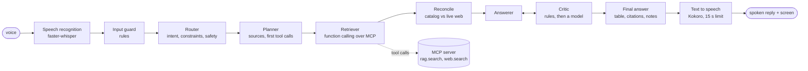

# Voice Shopping Copilot

*Final project for Applied Generative AI: Agents and Multimodal Intelligence (UChicago MS-ADS, Autumn 2026) · Mohan (Kevin) Li*

Ask for a product out loud. A team of LangGraph agents works out what you want, searches a private
catalog and the live web through one MCP server, and answers out loud in under 15 seconds, with a
three-way comparison on screen where every cell can be traced to a source.


> **Status (11 November 2026): the system runs end to end; the evaluation phase has not started.**
> Built and tested: data pipeline, hybrid retrieval, the MCP server, the agents, speech in and out, the API and
> the web UI. Not done yet: the ProofAgent evaluation and scorecard, the failure analyses, most of the written
> documentation. [PROGRESS.md](PROGRESS.md) is the build log; [docs/objectives.md](docs/objectives.md) lists every
> requirement of the assignment with where it is met.

## How a request is answered



| Stage | What it does | What is left to a model | What is not |
|---|---|---|---|
| Speech recognition | Whisper (`small.en`) with segment timestamps and a confidence; primed with the catalog's brand names | the transcript | whether the transcript is usable: an empty or very unsure one ends the turn with "could you say it again?" |
| Input guard | prompt injection, requests for secrets, dangerous chemistry, emergencies | nothing | fixed replies; an emergency reply gives the Poison Control number |
| Router | intent, constraints (budget, age, brand, material, wishes), safety flag | all of it | follow-up turns inherit earlier constraints in code |
| Planner | catalog, live web, or both; writes the first tool calls | strategy and queries | the budget and the age always become filters, whatever the model wrote |
| Retriever | calls `rag.search` and `web.search` through MCP tool discovery | extra calls when a search failed or found nothing | planned calls run without a model; duplicate and unknown calls are refused |
| Reconcile | matches live offers to catalog products; records price and stock conflicts | nothing | SKU, then model number, then brand plus every distinguishing title word |
| Answerer and Critic | picks up to three items by handle and writes the reasons and one spoken sentence | choice and wording | **every table cell, citation, count and safety note is filled in by code from the evidence** |
| Text to speech | Kokoro, sentence by sentence | nothing | the 15-second limit is enforced on the audio that was produced |

The catalog never contained ratings, brands or ingredient lists as usable fields, and nothing was made up to fill
them: brand and material are extracted from each listing's own text with their provenance recorded, and the rating
column says "not available" for catalog products. See [docs/decisions.md](docs/decisions.md).

## Try it

Requirements: macOS or Linux, Python 3.12, [uv](https://docs.astral.sh/uv/). An Anthropic API key and a
[Serper](https://serper.dev) key make it live; without them it still runs (rule-based agents, sample web data).

```bash
bash scripts/bootstrap_mac.sh        # .venv from uv.lock, the dataset, the local speech and retrieval models
cp -n .env.example .env              # keeps an existing .env; then add ANTHROPIC_API_KEY and SERPER_API_KEY
source .venv/bin/activate
voiceshop ingest && voiceshop index  # clean the catalog (9,741 products) and build the hybrid index
voiceshop serve                      # open http://127.0.0.1:8000 and press Talk
```

Without the browser:

```bash
voiceshop ask "a wooden puzzle for my three year old under twenty dollars" "is the second one in stock right now"
voiceshop voice question.m4a         # voice in, voice out; the reply is kept in logs/audio/
voiceshop mcp tools                  # what the agents discover on the MCP server
voiceshop eval retrieval             # the retrieval benchmark below
python -m pytest tests -q            # 475 tests, about 20 s, no key or network needed
```

`LLM_MODEL=fake:rules` runs every agent on rules only (no key, no cost); `LLM_MODEL=ollama:<model>` or any other
provider LangChain supports swaps the model without code changes.

## What has been measured so far

**Retrieval** — 600 spoken-style queries with one known target each, on an M2 Max
([full table](eval/results/retrieval/benchmark.md)):

| Variant | hit@1 | hit@3 | MRR@10 | in budget@3 | age ok@3 | p50 |
|---|---:|---:|---:|---:|---:|---:|
| BM25 | 81.0 | 91.0 | 0.866 | 77.9 | 76.5 | 0.3 ms |
| dense (bge-small) | 69.0 | 82.2 | 0.763 | 77.6 | 77.2 | 12 ms |
| hybrid (reciprocal-rank fusion) | 81.0 | 90.3 | 0.861 | 78.2 | 79.6 | 12 ms |
| hybrid + metadata filters | 83.3 | 92.2 | 0.881 | 100 | 100 | 58 ms |
| + re-rank all 40 candidates | 83.3 | 90.7 | 0.876 | 100 | 100 | 544 ms |
| + re-rank the first 10, fused (default) | 84.5 | 93.3 | 0.889 | 100 | 100 | 166 ms |

Two honest readings of that table: filters, not embeddings, are what guarantee the budget and the age; and the
cross-encoder is worth about one point, which is within the noise of 600 queries. It is kept because the score of
its best candidate flags 84% of requests the catalog cannot answer while wrongly flagging 2-3% of those it can.

**Live turns** (Claude Haiku 5.5 + Serper, 11 November 2026): 6-14 seconds and $0.002-0.005 per turn, before
any latency work. That first live run also found three defects, each now a regression test: a lunch box matched
to a brick box of the same brand, the assignment's own example answered with "I could not confirm…" because real
shopping listings carry no description, and a safety rule that read "no source confirms it is eco-friendly" as an
eco-friendly claim. They are written up in [docs/decisions.md](docs/decisions.md).

Still to come: the ProofAgent scorecard, groundedness with planted errors, word error rate across accented
voices, reconciliation accuracy on live listings, and stage-by-stage failure attribution.

## The MCP server

One server, exactly two tools, over stdio or streamable HTTP ([docs/mcp.md](docs/mcp.md)):

- `rag.search(query, filters, top_k)` — the private catalog: dense + BM25, metadata filters, a rule that a
  product for a child under three must say so in its own listing, and a "nothing relevant" signal.
- `web.search(query, max_results, kind, site, price_max)` — a search API (no page scraping) with a TTL cache,
  a rate limit, an allow/block list, prompt-injection stripping, and a log of every request and response.

The agents learn the tools from the server at start-up; nothing about them is written into the agent code.

## Where things are

```
src/voiceshop/
  data/         cleaning, attribute extraction with provenance, ingest        retrieval/   hybrid index and search engine
  mcp_server/   the two tools, cache, rate limit, providers, audit log        mcp_client/  discovery, tool restriction, adapters
  agents/       the LangGraph nodes, state, reconcile, claims, finalize       guardrails/  input screen, output rules, policy texts
  speech/       recognition, synthesis, text for speech                       api/         FastAPI + server-sent events
  evals/        retrieval and speech evaluation                               llm/         model factory, cost ledger
prompts/        every prompt, versioned, with a map of which node uses it     frontend/    the React UI (bundle committed)
eval/           datasets, experiments, results                                tests/       unit and end-to-end tests
docs/           objectives (requirement matrix), decisions (dated, with the evidence), the MCP reference
```

## Safety

Grounding is structural rather than hoped for: the models choose items by handle and write reasons, and code copies
prices, ratings, sources and citations from the evidence. Rule checks that cannot be argued with run before a
model critic; a draft that fails twice is replaced by a template answer built from the evidence. Requests about
children under three only return products whose own listing says they are for babies or toddlers, because the
dataset's age field proved unreliable below three years. Tool results are treated as data: instruction-like text
in a web result is removed and the result is flagged. Keys stay in `.env`; logs redact them.

## How this was built

I built this project with Claude (Anthropic's AI model) as the engineer: I set the objectives and constraints,
made the product decisions, ran everything on my own machine and checked the results; Claude wrote most of the
code, tests and documentation in this repository. The commit history carries a co-author line for that reason,
and [docs/decisions.md](docs/decisions.md) records what was decided, when, and on what evidence, including the
things that turned out to be wrong.
