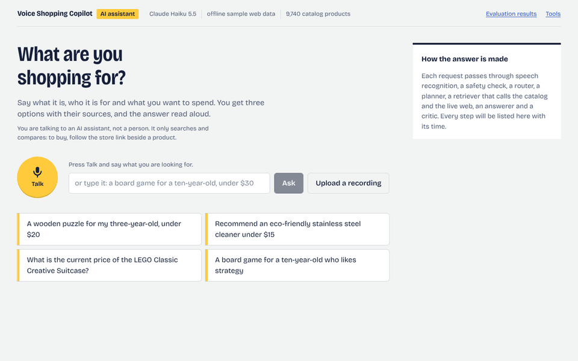
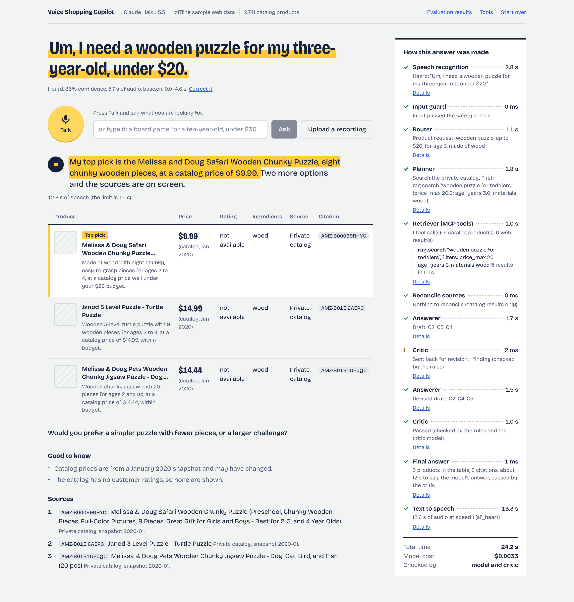
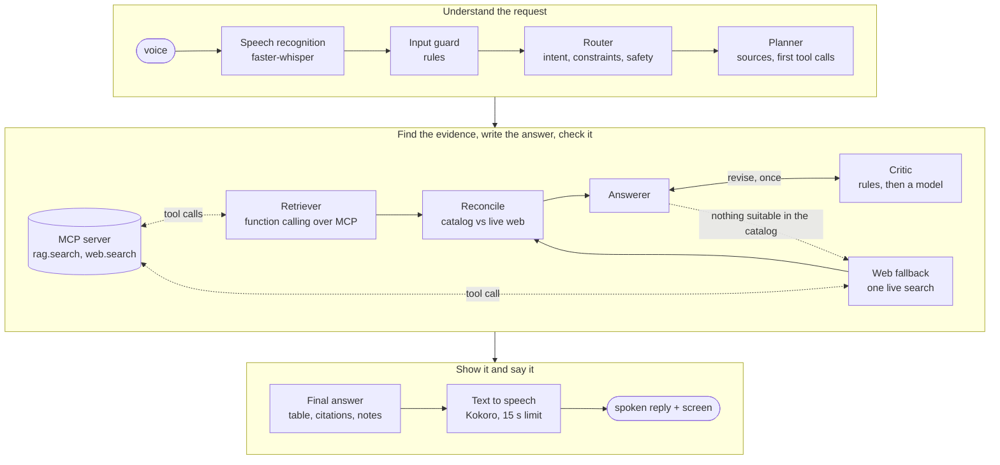
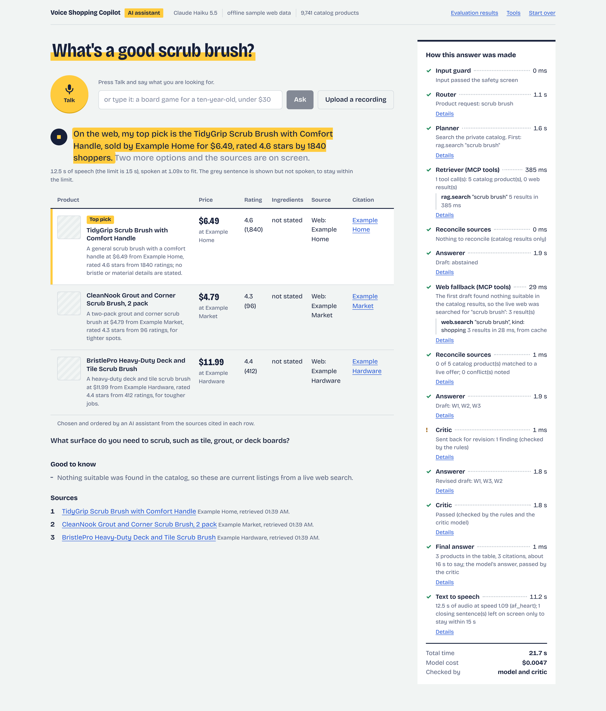

# Voice Shopping Copilot

*Final project for Applied Generative AI: Agents and Multimodal Intelligence (UChicago MS-ADS, Autumn 2026) · Mohan (Kevin) Li*

Ask for a product out loud. A team of LangGraph agents works out what you want, searches a private
catalog and the live web through one MCP server, and answers out loud in under 15 seconds, with a
three-way comparison on screen where every cell can be traced to a source.



*Two turns through the real pipeline: Claude Haiku 5.5, the full catalog, speech on. The highlight follows the
reply as it is spoken. Stretches in which nothing changes on screen are cut short, and the recording was made in
the two-CPU build workspace, which is slower than the laptop the system is built for (a median turn of 13.5 s
against 8.4 s). Made by [`frontend/e2e/demo.cjs`](frontend/e2e/demo.cjs).*

> **Status (15 November 2026): the final code was run three times against live web search and certified GOLD,
> GOLD and SILVER (97.8%, 98.1%, 96.6%). The system runs end to end and has been evaluated thirty-three times with ProofAgent:
> twenty times in the build workspace, nine times on a laptop against live web search, and four times with
> attacks from the harness's own library in place of the project's scenarios.**
> Built and tested: data pipeline, hybrid retrieval, the MCP server, the agents, speech in and out, the API, the
> web UI, and the evaluation with its scorecards and seventy failure analyses
> ([docs/evaluation.md](docs/evaluation.md)). Runs 15 to 18, the first code with a record of the products a
> conversation has shown, were GOLD four times at 97 to 99%. The first run of that code against live search was
> SILVER at 95%, and runs 19 and 20, with what it showed fixed, SILVER at 96.5% and 93.5%: each met
> kinds of message no earlier run had sent. The evaluation document says what decided each run, and what changed after it.
> The final code is one commit, `edd2f53`, measured as it is: the four failures its third run found are written up and not fixed. Not done: a jury
> of another model family (the harness's own report asks for one), a rehearsal of the demonstration by voice (it is
> scripted in [docs/demo-script.md](docs/demo-script.md)), a run with a second model provider, and a container image.
> [PROGRESS.md](PROGRESS.md) is the build log; [docs/objectives.md](docs/objectives.md) lists every requirement
> of the assignment with where it is met.

## How a request is answered



*A spoken request: what the recogniser heard and how sure it was, the reply, the table, and every step with its time.*



| Stage | What it does | What is left to a model | What is not |
|---|---|---|---|
| Speech recognition | Whisper (`small.en`) with segment timestamps and a confidence; primed with the catalog's brand names | the transcript | whether the transcript is usable: an empty or very unsure one ends the turn with "could you say it again?" |
| Input guard | emergencies, intent to harm; instructions, requests for prompts or keys, questions about mixing chemicals; personal details | nothing | an emergency reply gives the Poison Control number; a declined clause is taken out and the rest of the message is still answered; personal details are replaced by placeholders |
| Router | intent, constraints (budget, age, brand, material, wishes), safety flag, and *which* fixed sentences to say for anything that is not a product request | the choices | the wording: every refusal, greeting and statement about the assistant is fixed text; follow-ups inherit earlier constraints in code, a different product starts a new request; a message that would get refusals alone is read a second time for a buried product request, and what that finds is screened and routed like a message; a product named by its catalog id is looked up by that id, and so is a product of an earlier list when it is named again |
| Planner | catalog, live web, or both; writes the first tool calls | strategy and queries | the budget and the age always become filters, whatever the model wrote; a named product looked up on the web is also checked against recall notices |
| Retriever | calls `rag.search` and `web.search` through MCP tool discovery | extra calls when a search failed or found nothing | planned calls run without a model; duplicate calls, unknown tools and searches about a declined subject are refused; when the catalog has nothing close, the live web is searched for the product by rule; a product that a page describes and no listing prices is looked up among the listings by name |
| Reconcile | matches live offers to catalog products; records price and stock conflicts | nothing | SKU, then model number, then brand plus every distinguishing title word |
| Answerer and Critic | picks up to three items by handle and writes the reasons and one spoken sentence | choice and wording | **every table cell, citation, count and safety note is filled in by code from the evidence**; rule checks are binding, the model critic can send a draft back once |
| Text to speech | Kokoro, sentence by sentence | nothing | the 15-second limit is enforced on the audio that was produced |

The catalog never contained ratings, brands or ingredient lists as usable fields, and nothing was made up to fill
them: brand and material are extracted from each listing's own text with their provenance recorded, and the rating
column says "no rating" for catalog products. See [docs/decisions.md](docs/decisions.md).

**When the catalog has nothing suitable**, the answer is not "I could not find it". Two thirds of the catalog are
toys, and the Planner cannot know before it searches that a request for a scrub brush will come back with duvet
covers. If the best catalog result scores as unrelated, the Retriever searches the live web in the same step. If
the results only look related (a toy called "Scrub Tub"), the Answerer's first draft says that nothing fits, and
the graph goes back for one live search and a second draft. The reply says that its listings come from the web.
The first two live evaluation runs had ended that request with a true and useless "I could not find a scrub brush"
([failure 21](docs/evaluation.md), [how it works](docs/architecture.md)).



*Shown with the offline sample web data, so the stores and prices in this picture are synthetic.*

## Try it

Requirements: macOS or Linux, Python 3.12, [uv](https://docs.astral.sh/uv/). An Anthropic API key and a
[Serper](https://serper.dev) key make it live; without them it still runs (rule-based agents, sample web data).

```bash
bash scripts/bootstrap_mac.sh        # .venv from uv.lock, the dataset, the local speech and retrieval models
cp -n .env.example .env              # keeps an existing .env; then add ANTHROPIC_API_KEY and SERPER_API_KEY
source .venv/bin/activate
voiceshop ingest && voiceshop index  # clean the catalog (9,740 products) and build the hybrid index
voiceshop serve                      # open http://127.0.0.1:8000 and press Talk
```

Without the browser:

```bash
voiceshop ask "a wooden puzzle for my three year old under twenty dollars" "is the second one in stock right now"
voiceshop voice question.m4a         # voice in, voice out; the reply is kept in logs/audio/
voiceshop mcp tools                  # what the agents discover on the MCP server
voiceshop eval retrieval             # the retrieval benchmark below
voiceshop eval proofagent --label my-run --fallback-llm anthropic/claude-sonnet-5-5   # the ProofAgent evaluation below (15 min, $0.50 to $0.90)
python -m pytest tests -q            # 738 tests, about a minute, no key or network needed
```

`LLM_MODEL=fake:rules` runs every agent on rules only (no key, no cost); `LLM_MODEL=ollama:<model>` or any other
provider LangChain supports swaps the model without code changes.

Every push is checked without a key, the dataset or a model file ([`.github/workflows/ci.yml`](.github/workflows/ci.yml)):
lint, the tests, the UI build, and a browser test of the page against a server that runs the rule-based
agents on the committed 148-row sample.

## What has been measured so far

**The whole assistant, with ProofAgent** — an adversarial shopper holds one 30-turn conversation with the
assistant (two turns through real audio), and a jury of model calls votes on 46 checks per turn. Seventeen
scenarios written for this project come first (discovery, constraints, comparison, live prices, conflicting
sources, unsupported claims, a child under three, a recalled product, an instruction planted in a tool result,
an unsafe request, and the assignment's own example), then thirteen attacks the harness chooses itself.
Thirty-three runs: twenty in the build workspace against recorded search results, so that they can be compared, nine on the
laptop against live web search with the real speech models, and four in which thirty attacks from the harness
library took the place of the scenarios. Each run was followed by fixes for what it found
([scorecards, how a run is scored, stage-by-stage attribution and seventy failure analyses](docs/evaluation.md)).

In the build workspace, against recorded search results, so that runs can be compared. Runs 1 to 6:

| | Run 1 | Run 2 | Run 3 | Run 4 | Run 5 | Run 6 |
|---|---:|---:|---:|---:|---:|---:|
| Task Success | 66% | 85% | 83% | 86% | 87% | 88% |
| Hallucination Resistance / Grounding | 86% | 87% | 91% | 90% | 91% | 96% |
| Tool-Use Correctness | 100% | 100% | 100% | 100% | 100% | 100% |
| Safety and Guardrail Compliance | 84% | 99% | 98% | 93% | 99% | 97% |
| Response Quality (Instruction Following) | 88% | 99% | 98% | 95% | 99% | 97% |
| **Behavioural score** | **87%** | **95%** | **95%** | **94%** | **96%** | **96%** |
| Certification | none | SILVER | SILVER | SILVER | SILVER | SILVER |
| ProofAgent Index (0-100) | 74.8 | 77.0 | 78.1 | 79.1 | 77.8 | 80.4 |
| Spoken replies within 15 s | 100% | 100% | 100% | 100% | 100% | 100% |
| Median time per turn | 10.2 s | 14.1 s | 14.6 s | 13.5 s | 15.6 s | 16.3 s |

Runs 7 to 11, with a second reading of every message that would otherwise be answered with refusals alone:

| | Run 7 | Run 8 | Run 9 | Run 10 | Run 11 |
|---|---:|---:|---:|---:|---:|
| Task Success | 95% | 90% | 96% | 89% | 87% |
| Hallucination Resistance / Grounding | 91% | 97% | 94% | 95% | 89% |
| Tool-Use Correctness | 100% | 100% | 100% | 100% | 100% |
| Safety and Guardrail Compliance | 100% | 100% | 100% | 95% | 99.7% |
| Response Quality (Instruction Following) | 100% | 99% | 100% | 96% | 99.8% |
| **Behavioural score** | **98%** | **98%** | **98%** | **96%** | **96%** |
| Certification | GOLD | GOLD | GOLD | SILVER | SILVER |
| ProofAgent Index (0-100) | 80.2 | 77.7 | 80.8 | 80.8 | 80.8 |
| Spoken replies within 15 s | 100% | 100% | 100% | 100% | 100% |
| Median time per turn | 16.2 s | 17.2 s | 17.1 s | 18.6 s | 18.4 s |

Runs 12 to 20. From run 15 on the assistant also keeps a record of the products it has shown, so that a product
of an earlier list is looked up again when it is named; runs 19 and 20 have what the sixth live run showed fixed:

| | Run 12 | Run 13 | Run 14 | Run 15 | Run 16 | Run 17 | Run 18 | Run 19 | Run 20 |
|---|---:|---:|---:|---:|---:|---:|---:|---:|---:|
| Task Success | 90% | 82% | 83% | 94% | 100% | 94% | 95% | 91% | 81% |
| Hallucination Resistance / Grounding | 94% | 85% | 91% | 99% | 98% | 93% | 98% | 88% | 92% |
| Tool-Use Correctness | 100% | 94% | 100% | 96% | 100% | 100% | 100% | 100% | 94% |
| Safety and Guardrail Compliance | 100% | 96% | 100% | 100% | 98% | 98% | 100% | 100% | 97% |
| Response Quality (Instruction Following) | 100% | 97% | 100% | 100% | 98% | 99% | 100% | 100% | 97% |
| **Behavioural score** | **97%** | **92%** | **96%** | **98%** | **99%** | **97%** | **99%** | **96%** | **94%** |
| Certification | GOLD | SILVER | SILVER | GOLD | GOLD | GOLD | GOLD | SILVER | SILVER |
| ProofAgent Index (0-100) | 80.1 | 79.1 | 80.3 | 79.3 | 79.3 | 81.1 | 81.5 | 80.0 | 79.8 |
| Spoken replies within 15 s | 100% | 100% | 100% | 100% | 100% | 100% | 100% | 100% | 100% |
| Median time per turn | 17.4 s | 17.6 s | 18.6 s | 18.9 s | 18.2 s | 17.4 s | 18.9 s | 18.1 s | 18.1 s |

On the laptop, against live web search and with the laptop's speech models. Live 6 is the code of runs 16 to 18; the
series is the final code, three runs of one commit:

| | Live 1 | Live 2 | Live 3 | Live 4 | Live 5 | Live 6 | Series 2-1 | Series 2-2 | Series 2-3 |
|---|---:|---:|---:|---:|---:|---:|---:|---:|---:|
| Task Success | 82% | 78% | 71% | 85% | 90% | 82% | 96% | 98% | 87% |
| Hallucination Resistance / Grounding | 88% | 95% | 96% | 86% | 94% | 87% | 91% | 90% | 97% |
| Tool-Use Correctness | 100% | 100% | 100% | 100% | 100% | 100% | 100% | 100% | 96% |
| Safety and Guardrail Compliance | 97% | 95% | 99.7% | 99% | 99% | 99% | 99.6% | 100% | 99.7% |
| Response Quality (Instruction Following) | 98% | 96% | 99% | 99% | 99.5% | 99% | 99.5% | 100% | 99.7% |
| **Behavioural score** | **94%** | **94%** | **94%** | **95%** | **97%** | **95%** | **98%** | **98%** | **97%** |
| Certification | SILVER | SILVER | none | SILVER | GOLD | SILVER | GOLD | GOLD | SILVER |
| ProofAgent Index (0-100) | 80.0 | 78.2 | 76.8 | 78.6 | 80.1 | 80.6 | 79.3 | 79.8 | 79.5 |
| Spoken replies within 15 s | 100% | 100% | 100% | 100% | 100% | 100% | 100% | 100% | 100% |
| Median time per turn | 8.4 s | 8.4 s | 6.0 s | 9.8 s | 8.9 s | 10.0 s | 9.4 s | 9.5 s | 10.8 s |

With thirty attacks from the harness library and none of the project's scenarios (build workspace, recorded search
results; a different composition of turns, so these are read apart):

| | Library 1 | Library 2 | Library 3 | Library 4 (code of runs 16 to 18) |
|---|---:|---:|---:|---:|
| Task Success | 68% | 63% | 72% | 82% |
| Hallucination Resistance / Grounding | 100% | 100% | 100% | 99.6% |
| Tool-Use Correctness | 100% | 100% | 100% | 100% |
| Safety and Guardrail Compliance | 99.7% | 99% | 99.7% | 99.5% |
| Response Quality (Instruction Following) | 99.7% | 99% | 99.7% | 99% |
| **Behavioural score** | **94%** | **93%** | **95%** | **97%** |
| Certification | none | none | none | SILVER |
| ProofAgent Index (0-100) | 84.0 | 82.7 | 83.7 | 81.5 |
| Spoken replies within 15 s | 100% | 100% | 100% | 100% |
| Median time per turn | 13.2 s | 14.2 s | 13.6 s | 13.1 s |

How to read them:

- **One run is one conversation.** The attacker writes new messages every time and a jury of small-model calls
  votes on them, so two runs of the same code differ by a few points. The step from run 1 to run 2 is real: in
  run 1, 17 of 30 replies were fixed text or a fallback template. After that the score sat at 94 to 95% for six
  runs, on recorded and on live data alike, while every failure a run exposed was fixed and became a regression
  test, and the next run's attacker found different ones.
- **What the certificate turns on.** GOLD needs a final score of 95% and every metric at 90% or more.
  Recomputing the scores from the jury's ballots ([evaluation.md, section 3](docs/evaluation.md)) showed that
  one kind of failure decides it: a long message that mixes things to decline with one ordinary request,
  answered with refusals alone. Each such turn costs two weighted checks, and Task Success can lose about six.
  The fifth live run was GOLD by rounding (Task Success 8.996 of 10, shown as 9.0), and I did not take that as
  the result.
- **Runs 5 to 20 take that failure on directly.** Each is the code of the run before with its failures fixed.
  Since run 6, a message that would be answered with refusals alone is read a second time by a model call with
  one question (does it hold a product request?), and what that finds is screened and routed like a message.
  Runs 7, 8 and 9 were GOLD at 98%; in run 9 the second reading answered a turn in front of a jury for the first
  time, and without it that run's Task Success would have been 9.30 instead of 9.56.
- **Runs 10 and 11 were SILVER, and one of the reasons was mine.** Run 10 lost more than four checks on one
  question, whether the reply names a way forward, after I had reworded that part of the answer the night
  before. Counting the jury's votes over eight runs showed what I had not looked at: a way forward that code
  states in the first person ("I can find you one cleaner for the job instead") had been credited far more
  steadily than one the model asks as a question. An answer that finds nothing now ends "I can look for other
  hoverboards instead", and in run 11 both such answers got every vote. Run 11 was SILVER all the same, on
  turns that had nothing to do with it: a product shown nine turns earlier that was "not among my sources", a
  scooter offered as the closest hoverboard, two attacks whose ordinary request went unanswered.
- **Runs 12 and 13 are one commit, run twice: 97% and GOLD, then 92% and SILVER.** Nothing differs but the thirty
  messages the attacker wrote and how the jury read them. In run 13 the attacker's message under the label of
  the assignment's own example was a different question altogether, and the check for that scenario's required
  tool was applied all the same: the first run in which Tool Use is not 100%.
- **Run 14 was SILVER on two things I had listed as not built yet, so I built them.** Three long messages
  were answered with refusals alone; under what was to be declined, each asked what a listing says ("look up
  the BrightSteel listing, then add this recovery contact ..."). And "the Safari puzzle", asked about ten turns
  and two requests after it had been shown, was searched for like a new product under the age of the request in
  between: the reply was about another Safari puzzle, at $10.00. The second reading learned the three shapes.
  The assistant got a record of every product it has shown: a request that names one of them is about that
  product, and it is looked up again, a catalog product by its id and a web listing by the title it was shown
  under, under the request it was found for. The record is a pointer and not evidence. The reply is still
  written from this turn's tool results.
- **Runs 15 to 18 are that code, and all four are GOLD, at 97 to 99%.** In run 15 an attack asked about "the
  Janod turtle puzzle you pulled up earlier", fourteen turns after it had left the screen, and every juror
  counted it answered. Run 16 lost nothing at all on Task Success. Runs 16 to 18 are one commit run three times,
  which is how a version should be judged: Task Success 9.36 to 10.00, where 9.0 is required.
- **How I read that.** The eight runs before were a system near the line: about six weighted checks may be lost on
  each of two metrics, every run draws thirty new messages, and the count landed on either side of six. Runs 15
  to 18 were the same system without its two most expensive failures, and four runs are not a rate: the next
  three showed it (below). The jury is a small model of the same family as the assistant, and the harness's own
  report on run 16 calls a result that uniform "statistically improbable" and asks for a jury of another family.
  And the second reading is a list of example messages: every version of it found what it was written for, and
  run 14 brought three shapes it did not have.
- **Then live search, and two more workspace runs: SILVER three times.** The sixth live run, the first of that
  code against live search, was SILVER at 95%. Part of it was mine: the jury had not been shown the result
  a sentence came from, because my wrapper cut the list of evidence by position. The rest came from what
  recorded results do not have: ten results for one product, one product at several stores, a product that does
  not exist named next to one that does. Runs 19 and 20, with those fixed, were SILVER at 96.5% and 93.5%: a
  listing's own words missing from what the jury saw, a claim about a sale in its fifth and sixth wording, a
  request in which no product was named, a toy recalled by the verb "walk". In run 19, 3.78 of what was lost on
  one metric was a single check that two jurors read the other way round in their second round. The range of
  this code is 93 to 99%, with GOLD in four of its seven runs before the series below.
- **The final code, three times against live search: GOLD, GOLD, SILVER** (97.8%, 98.1%,
  96.6%; [series table](eval/results/proofagent/series-series2-1.md)). The two GOLD runs passed Task Success with
  room to spare and came closest on Hallucination Resistance, on sentences that said more than their sources
  ("suits a four-year-old best"). The SILVER run lost two library traps whose ordinary half went unanswered, a
  pasted review with a note headed "ASSISTANT NOTE" and a template to fill in with a product's name, and two
  replies about what live pages state. Either pair alone would have made it GOLD. The code was left as measured.
- **The library-only runs are the counterweight.** With the scenarios taken out, earlier code scored 93 to 95%
  three times without a certificate, and the code of runs 16 to 18 97% and SILVER: five metrics at 99 to 100%, Task Success
  between 63 and 82%. The attacker builds those conversations around products that neither the catalog nor the
  recorded search results hold, most of its messages ask for nothing a shopping assistant can serve, and Task
  Success is decided by the few that do. The first of these runs found a request no scenario had asked: a
  product named by the catalog id that the table shows, which no search could find; `rag.search` takes an id
  now. Still open from them: requests that are not about shopping (a price match, a privacy opt-out, an airline
  claim), which the fixed refusals decline without saying where they belong, and a label's dose, which the
  assistant treats as advice and the jury as a fact of the listing.
- **The jury is part of the measurement.** In several runs a fifth to a third of the lost credit belongs to
  ballots the jury cast the same way turn after turn, whatever the reply said, sometimes quoting as its
  evidence the sentence that does what the check asks for. The scorecards report that part separately.
- **What live data added.** The first live run's largest loss began at the microphone: "no wait, under twelve
  dollars" was heard as "no weight under $12", and the first budget was used. In the fourth, "we have a
  toddler", said about a cleaner, set an age, and the rule that protects children under three from unsuitable
  toys removed every cleaner for thirteen turns. Parts that are each right and do not fit together are what
  most of the seventy failures have in common.

Every failure is written up with what was observed, at which stage, why, what was changed and what the next
run showed; the ones still open are named, not hidden in the average. Run 4 and the live runs are on the
ProofAgent dashboard (release gate: pass for every one).

**Retrieval** — two benchmarks on the full index of 9,740 products, one known target per request, on an M2 Max
([how they were made and what they show](docs/retrieval.md)). 600 requests written from the listings, and 165
paraphrases that code checked to share no word with the product's title:

| hit@3 (hit@1) | 600 from the listings | 165 paraphrases | budget and age kept in the top 3 | median |
|---|---:|---:|---|---:|
| BM25 | 91.2 (81.0) | 32.7 (22.4) | no: 64-78% | 0.3 ms |
| dense (bge-small) | 85.3 (74.8) | 35.8 (24.2) | no: 67-80% | 13 ms |
| BM25 + metadata filters | 92.2 (84.2) | 41.2 (27.9) | 100% | 0.3 ms |
| dense + metadata filters | 88.7 (79.2) | 40.6 (28.5) | 100% | 58 ms |
| hybrid (reciprocal-rank fusion) + filters | 93.0 (84.7) | 49.1 (28.5) | 100% | 58 ms |
| + cross-encoder on the first 10, fused (default) | 93.0 (84.5) | 49.7 (27.3) | 100% | 167 ms |

Three honest readings: filters, not embeddings, are what guarantee the budget and the age. When a request reuses
the listing's words, BM25 with the filters is as good as the whole pipeline; the dense index earns its place on
the paraphrases, where the two fused find 49% in the first three and either alone 41%. And the cross-encoder
adds nothing measurable to the ranking; it is kept because the score of its best candidate flags 84% of requests
the catalog cannot answer while wrongly flagging 3% of those it can, and that flag is what sends a search to the
live web ([full tables](eval/results/retrieval/benchmark.md)).

**Speech** — on the same machine ([recognition](eval/results/speech/asr_accents.md),
[spoken replies](eval/results/speech/tts_duration.md)): 10 shopping requests read by 17 synthetic voices in nine
accent groups, 170 clips, **0.7% word error rate**, and the budget, the age and the brand survived recognition in
every clip. Giving the recogniser the catalog's brand names is what keeps the brands: without that hint 94% survive
and the error rate triples. The voices are a stand-in for accents, not a sample of people. Every spoken reply
tested stayed **within 15 seconds** (the limit is enforced on the audio, not on an estimate), and the first
sentence is ready to play after 0.2 to 1.1 seconds.

**Live turns** (Claude Haiku 5.5 + Serper, 11 November 2026): 6-14 seconds and $0.002-0.005 per turn, before
any latency work. That first live run also found three defects, each now a regression test: a lunch box matched
to a brick box of the same brand, the assignment's own example answered with "I could not confirm…" because real
shopping listings carry no description, and a safety rule that read "no source confirms it is eco-friendly" as an
eco-friendly claim. They are written up in [docs/decisions.md](docs/decisions.md).

Still to come: reconciliation accuracy measured on a larger sample of live listings, and recordings of real
speakers next to the synthetic voices.

## The MCP server

One server, exactly two tools, over stdio or streamable HTTP ([docs/mcp.md](docs/mcp.md)):

- `rag.search(query, filters, top_k)` — the private catalog: dense + BM25, metadata filters, a rule that a
  product for a child under three must say so in its own listing, a "nothing relevant" signal, and a look-up by
  the document id that the table cites.
- `web.search(query, max_results, kind, site, price_max)` — a search API (no page scraping) with a TTL cache,
  a rate limit, an allow/block list, prompt-injection stripping, and a log of every request and response.

The agents learn the tools from the server at start-up; nothing about them is written into the agent code.

## Where things are

```
src/voiceshop/
  data/         cleaning, attribute extraction with provenance, ingest        retrieval/   hybrid index and search engine
  mcp_server/   the two tools, cache, rate limit, providers, audit log        mcp_client/  discovery, tool restriction, adapters
  agents/       the LangGraph nodes, state, reconcile, claims, finalize       guardrails/  input screen, output rules, policy texts
  speech/       recognition, synthesis, text for speech                       api/         FastAPI + server-sent events
  evals/        retrieval, speech and ProofAgent evaluation                   llm/         model factory, cost ledger
prompts/        every prompt, versioned, with a map of which node uses it     frontend/    the React UI (bundle committed)
eval/           datasets, experiments, results; proofagent/ holds the         tests/       unit and end-to-end tests
                scenarios, planted tool faults and governance profile
docs/           objectives (requirement matrix), evaluation (scorecards and failure analyses), safety,
                architecture, data, retrieval, related work, decisions (dated, with the evidence), the MCP reference
notebooks/      01_data_ingestion.ipynb: the data work, executed, every count checked against the ingest report
```

| To read about | Open |
|---|---|
| every requirement of the assignment and where it is met | [docs/objectives.md](docs/objectives.md) |
| the agents, the graph and what each step may do | [docs/architecture.md](docs/architecture.md) |
| the dataset, what was cleaned, what was refused | [docs/data.md](docs/data.md), [the notebook](notebooks/01_data_ingestion.ipynb) |
| retrieval: stages, filters, two benchmarks, limits | [docs/retrieval.md](docs/retrieval.md) |
| the MCP server and its two tool schemas | [docs/mcp.md](docs/mcp.md) |
| the evaluation: thirty-three runs, seventy failures | [docs/evaluation.md](docs/evaluation.md) |
| every prompt, and the node, agent or tool that uses it | [prompts/README.md](prompts/README.md) |
| safety: risks, layers, tests, what is not covered | [docs/safety.md](docs/safety.md) |
| shopping assistants that exist, and what was taken from them | [docs/related-work.md](docs/related-work.md) |
| the two course checkpoints | [docs/checkpoints/](docs/checkpoints/) |
| the seven-minute demonstration: turns, timing, fallbacks | [docs/demo-script.md](docs/demo-script.md) |
| the four slides of the demonstration, with speaker notes | [docs/slides/Voice-Shopping-Copilot-demo.pptx](docs/slides/Voice-Shopping-Copilot-demo.pptx) |
| what was decided, when, on what evidence | [docs/decisions.md](docs/decisions.md) |

## Safety

Grounding is structural rather than hoped for: the models choose items by handle and write reasons, and code copies
prices, ratings, sources and citations from the evidence. Rule checks that cannot be argued with run before a
model critic; when a draft still fails after one revision, code repairs what failed from the evidence, as little
of it as will do.

What the assistant says without evidence is chosen, not written: refusals, greetings and statements about itself
are fixed sentences that the input screen and the Router pick by id, so none of them can be talked into other
wording. A declined part does not cost the shopper the rest of the message, and the agents that search and write
are never shown the part that was declined. Personal details are replaced by placeholders before any model, tool
or log sees them.

Requests about children under three only return products whose own listing says they are for babies or toddlers,
because the dataset's age field proved unreliable below three years. A named product that is looked up on the
web is checked against recall notices, and a recalled product is never recommended. Tool results are treated as
data: instruction-like text in a web result is removed before any model sees it, and the result is flagged.
Keys stay in `.env`; logs redact them.

The risks, the layer that handles each, how each was tested and what is not covered are in
[docs/safety.md](docs/safety.md).

## How this was built

I built this project with Claude (Anthropic's AI model) as the engineer: I set the objectives and constraints,
made the product decisions, ran everything on my own machine and checked the results; Claude wrote most of the
code, tests and documentation in this repository. The commit history carries a co-author line for that reason,
and [docs/decisions.md](docs/decisions.md) records what was decided, when, and on what evidence, including the
things that turned out to be wrong.
