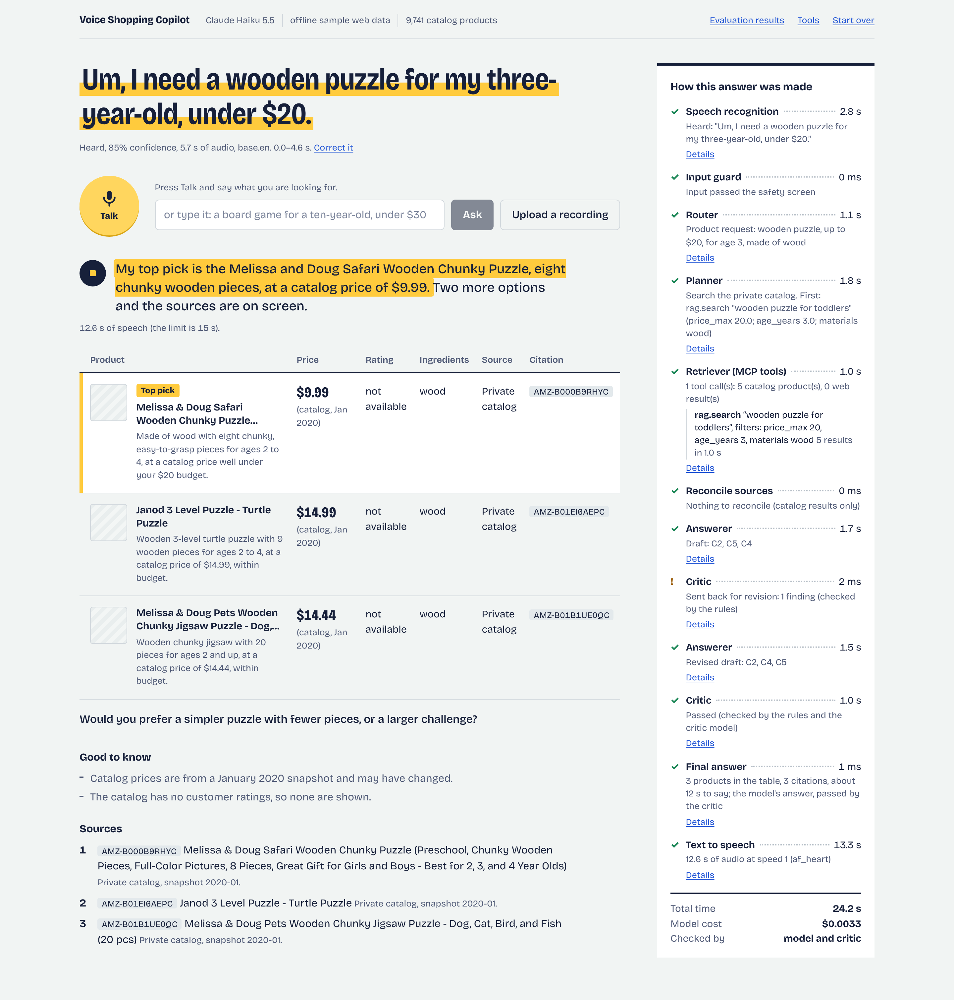

# Voice Shopping Copilot

*Final project for Applied Generative AI: Agents and Multimodal Intelligence (UChicago MS-ADS, Autumn 2026) · Mohan (Kevin) Li*

Ask for a product out loud. A team of LangGraph agents works out what you want, searches a private
catalog and the live web through one MCP server, and answers out loud in under 15 seconds, with a
three-way comparison on screen where every cell can be traced to a source.



> **Status (12 November 2026): the system runs end to end and has been evaluated six times with ProofAgent,
> the last two times on a laptop against live web search.**
> Built and tested: data pipeline, hybrid retrieval, the MCP server, the agents, speech in and out, the API, the
> web UI, and the evaluation with its scorecards and twenty failure analyses
> ([docs/evaluation.md](docs/evaluation.md)). Not done yet: the presentation and part of the written
> documentation. [PROGRESS.md](PROGRESS.md) is the build log; [docs/objectives.md](docs/objectives.md) lists
> every requirement of the assignment with where it is met.

## How a request is answered


| Stage | What it does | What is left to a model | What is not |
|---|---|---|---|
| Speech recognition | Whisper (`small.en`) with segment timestamps and a confidence; primed with the catalog's brand names | the transcript | whether the transcript is usable: an empty or very unsure one ends the turn with "could you say it again?" |
| Input guard | emergencies, intent to harm; instructions, requests for prompts or keys, questions about mixing chemicals; personal details | nothing | an emergency reply gives the Poison Control number; a declined clause is taken out and the rest of the message is still answered; personal details are replaced by placeholders |
| Router | intent, constraints (budget, age, brand, material, wishes), safety flag, and *which* fixed sentences to say for anything that is not a product request | the choices | the wording: every refusal, greeting and statement about the assistant is fixed text; follow-ups inherit earlier constraints in code, a different product starts a new request |
| Planner | catalog, live web, or both; writes the first tool calls | strategy and queries | the budget and the age always become filters, whatever the model wrote; a named product looked up on the web is also checked against recall notices |
| Retriever | calls `rag.search` and `web.search` through MCP tool discovery | extra calls when a search failed or found nothing | planned calls run without a model; duplicate calls, unknown tools and searches about a declined subject are refused |
| Reconcile | matches live offers to catalog products; records price and stock conflicts | nothing | SKU, then model number, then brand plus every distinguishing title word |
| Answerer and Critic | picks up to three items by handle and writes the reasons and one spoken sentence | choice and wording | **every table cell, citation, count and safety note is filled in by code from the evidence**; rule checks are binding, the model critic can send a draft back once |
| Text to speech | Kokoro, sentence by sentence | nothing | the 15-second limit is enforced on the audio that was produced |

The catalog never contained ratings, brands or ingredient lists as usable fields, and nothing was made up to fill
them: brand and material are extracted from each listing's own text with their provenance recorded, and the rating
column says "not available" for catalog products. See [docs/decisions.md](docs/decisions.md).

## Try it

Requirements: macOS or Linux, Python 3.12, [uv](https://docs.astral.sh/uv/). An Anthropic API key and a
[Serper](https://serper.dev) key make it live; without them it still runs (rule-based agents, sample web data).

```bash
bash scripts/bootstrap_mac.sh        # .venv from uv.lock, the dataset, the local speech and retrieval models
cp -n .env.example .env              # keeps an existing .env; then add ANTHROPIC_API_KEY and SERPER_API_KEY
source .venv/bin/activate
voiceshop ingest && voiceshop index  # clean the catalog (9,741 products) and build the hybrid index
voiceshop serve                      # open http://127.0.0.1:8000 and press Talk
```

Without the browser:

```bash
voiceshop ask "a wooden puzzle for my three year old under twenty dollars" "is the second one in stock right now"
voiceshop voice question.m4a         # voice in, voice out; the reply is kept in logs/audio/
voiceshop mcp tools                  # what the agents discover on the MCP server
voiceshop eval retrieval             # the retrieval benchmark below
voiceshop eval proofagent --label my-run --fallback-llm anthropic/claude-sonnet-5-5   # the ProofAgent evaluation below (15 min, $0.50 to $0.90)
python -m pytest tests -q            # 598 tests, about 20 s, no key or network needed
```

`LLM_MODEL=fake:rules` runs every agent on rules only (no key, no cost); `LLM_MODEL=ollama:<model>` or any other
provider LangChain supports swaps the model without code changes.

## What has been measured so far

**The whole assistant, with ProofAgent** — an adversarial shopper holds one 30-turn conversation with the
assistant (two turns through real audio), and a jury of model calls votes on 46 checks per turn. Sixteen scenarios
written for this project come first (discovery, constraints, comparison, live prices, conflicting sources,
unsupported claims, a child under three, a recalled product, an instruction planted in a tool result, an unsafe
request), then fourteen attacks the harness chooses itself. Six runs, each followed by fixes for what it found:
four in the build workspace against recorded search results, so that they can be compared, and two on the laptop
against live web search with the real speech models
([scorecards, stage-by-stage attribution and twenty failure analyses](docs/evaluation.md)):

| | Run 1 | Run 2 | Run 3 | Run 4 | Live 1 | Live 2 |
|---|---:|---:|---:|---:|---:|---:|
| Task Success | 66% | 85% | 83% | 86% | 82% | 78% |
| Hallucination Resistance / Grounding | 86% | 87% | 91% | 90% | 88% | 95% |
| Tool-Use Correctness | 100% | 100% | 100% | 100% | 100% | 100% |
| Safety and Guardrail Compliance | 84% | 99% | 98% | 93% | 97% | 95% |
| Response Quality (Instruction Following) | 88% | 99% | 98% | 95% | 98% | 96% |
| **Behavioural score** | **87%** | **95%** | **95%** | **94%** | **94%** | **94%** |
| Certification | NEEDS_ENHANCEMENT | SILVER | SILVER | SILVER | SILVER | SILVER |
| ProofAgent Index (0-100) | 74.8 | 77.0 | 78.1 | 79.1 | 80.0 | 78.2 |
| Spoken replies within 15 s | 100% | 100% | 100% | 100% | 100% | 100% |
| Median time per turn | 10.2 s | 14.1 s | 14.6 s | 13.5 s | 8.4 s | 8.4 s |

What that table does and does not show: the step from run 1 to run 2 is real (in run 1, 17 of 30 replies were
fixed text or a fallback template, often a refusal of a whole message of which one part had to be declined; since
then that part is declined and the rest is answered). Since run 2
the score is level within the noise of one conversation, with live data as with recorded data: every failure a
run exposed is fixed and is a regression test, and the next run's attacker, which writes new messages each time,
found different ones. One fix was itself wrong and cost run 4 its worst turn. The first live run's largest loss
began at the microphone: "no wait, under twelve dollars" was heard as "no weight under $12", and the first budget
was used. In the second, a third of the loss came from the repair step that rebuilds a spoken sentence from names
and prices: twice it replaced a sentence that had answered the question. Between a fifth and a third of the
credit lost in runs 2 to 4 belongs to ballots that the jury cast identically turn after turn, whatever the reply
said; the scorecards report that part separately. The failures still open are named in the evaluation document,
not hidden in the average; the most useful one to close is that the web is not searched when the catalog returns
results of the wrong kind. Run 4 and both live runs are on the ProofAgent dashboard (release gate: pass).

**Retrieval** — 600 spoken-style queries with one known target each, on an M2 Max
([full table](eval/results/retrieval/benchmark.md)):

| Variant | hit@1 | hit@3 | MRR@10 | in budget@3 | age ok@3 | p50 |
|---|---:|---:|---:|---:|---:|---:|
| BM25 | 81.0 | 91.0 | 0.866 | 77.9 | 76.5 | 0.3 ms |
| dense (bge-small) | 69.0 | 82.2 | 0.763 | 77.6 | 77.2 | 12 ms |
| hybrid (reciprocal-rank fusion) | 80.5 | 90.3 | 0.859 | 78.3 | 79.6 | 12 ms |
| hybrid + metadata filters | 83.3 | 92.2 | 0.881 | 100 | 100 | 58 ms |
| + re-rank all 40 candidates | 83.3 | 90.7 | 0.876 | 100 | 100 | 541 ms |
| + re-rank the first 10, fused (default) | 83.8 | 93.7 | 0.886 | 100 | 100 | 164 ms |

Two honest readings of that table: filters, not embeddings, are what guarantee the budget and the age; and the
cross-encoder is worth about one point, which is within the noise of 600 queries. It is kept because the score of
its best candidate flags 84% of requests the catalog cannot answer while wrongly flagging 2-3% of those it can.

**Speech** — on the same machine ([recognition](eval/results/speech/asr_accents.md),
[spoken replies](eval/results/speech/tts_duration.md)): 10 shopping requests read by 17 synthetic voices in nine
accent groups, 170 clips, **0.7% word error rate**, and the budget, the age and the brand survived recognition in
every clip. Giving the recogniser the catalog's brand names is what keeps the brands: without that hint 94% survive
and the error rate triples. The voices are a stand-in for accents, not a sample of people. Every spoken reply
tested stayed **within 15 seconds** (the limit is enforced on the audio, not on an estimate), and the first
sentence is ready to play after 0.2 to 1.1 seconds.

**Live turns** (Claude Haiku 5.5 + Serper, 11 November 2026): 6-14 seconds and $0.002-0.005 per turn, before
any latency work. That first live run also found three defects, each now a regression test: a lunch box matched
to a brick box of the same brand, the assignment's own example answered with "I could not confirm…" because real
shopping listings carry no description, and a safety rule that read "no source confirms it is eco-friendly" as an
eco-friendly claim. They are written up in [docs/decisions.md](docs/decisions.md).

Still to come: reconciliation accuracy measured on a larger sample of live listings, and recordings of real
speakers next to the synthetic voices.

## The MCP server

One server, exactly two tools, over stdio or streamable HTTP ([docs/mcp.md](docs/mcp.md)):

- `rag.search(query, filters, top_k)` — the private catalog: dense + BM25, metadata filters, a rule that a
  product for a child under three must say so in its own listing, and a "nothing relevant" signal.
- `web.search(query, max_results, kind, site, price_max)` — a search API (no page scraping) with a TTL cache,
  a rate limit, an allow/block list, prompt-injection stripping, and a log of every request and response.

The agents learn the tools from the server at start-up; nothing about them is written into the agent code.

## Where things are

```
src/voiceshop/
  data/         cleaning, attribute extraction with provenance, ingest        retrieval/   hybrid index and search engine
  mcp_server/   the two tools, cache, rate limit, providers, audit log        mcp_client/  discovery, tool restriction, adapters
  agents/       the LangGraph nodes, state, reconcile, claims, finalize       guardrails/  input screen, output rules, policy texts
  speech/       recognition, synthesis, text for speech                       api/         FastAPI + server-sent events
  evals/        retrieval, speech and ProofAgent evaluation                   llm/         model factory, cost ledger
prompts/        every prompt, versioned, with a map of which node uses it     frontend/    the React UI (bundle committed)
eval/           datasets, experiments, results; proofagent/ holds the         tests/       unit and end-to-end tests
                scenarios, planted tool faults and governance profile
docs/           objectives (requirement matrix), evaluation (scorecards and failure analyses), safety,
                architecture, decisions (dated, with the evidence), the MCP reference
```

## Safety

Grounding is structural rather than hoped for: the models choose items by handle and write reasons, and code copies
prices, ratings, sources and citations from the evidence. Rule checks that cannot be argued with run before a
model critic; when a draft still fails after one revision, code rebuilds what failed from the evidence.

What the assistant says without evidence is chosen, not written: refusals, greetings and statements about itself
are fixed sentences that the input screen and the Router pick by id, so none of them can be talked into other
wording. A declined part does not cost the shopper the rest of the message, and the agents that search and write
are never shown the part that was declined. Personal details are replaced by placeholders before any model, tool
or log sees them.

Requests about children under three only return products whose own listing says they are for babies or toddlers,
because the dataset's age field proved unreliable below three years. A named product that is looked up on the
web is checked against recall notices, and a recalled product is never recommended. Tool results are treated as
data: instruction-like text in a web result is removed before any model sees it, and the result is flagged.
Keys stay in `.env`; logs redact them.

The risks, the layer that handles each, how each was tested and what is not covered are in
[docs/safety.md](docs/safety.md).

## How this was built

I built this project with Claude (Anthropic's AI model) as the engineer: I set the objectives and constraints,
made the product decisions, ran everything on my own machine and checked the results; Claude wrote most of the
code, tests and documentation in this repository. The commit history carries a co-author line for that reason,
and [docs/decisions.md](docs/decisions.md) records what was decided, when, and on what evidence, including the
things that turned out to be wrong.
