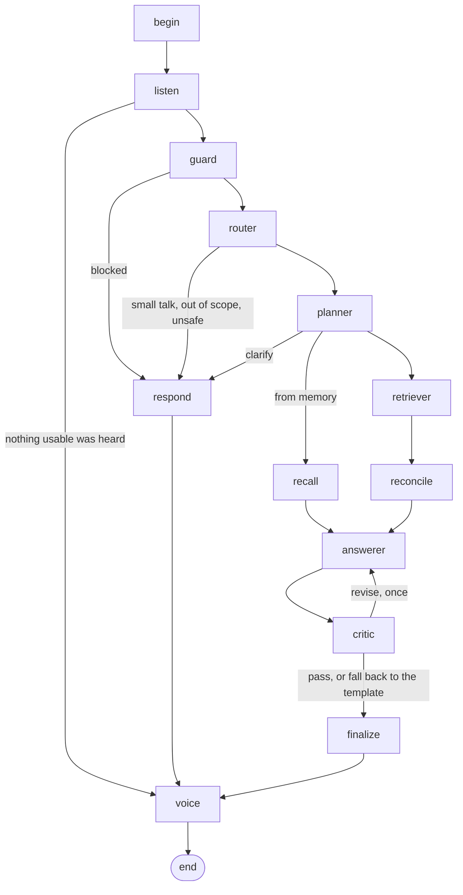

# Architecture

How one request travels through the system, what each part is responsible for, and what happens when a part
fails. Code references are to `src/voiceshop/`.

## The pieces

```
browser (frontend/)  --HTTP + server-sent events-->  api/app.py  -->  assistant.py (Assistant)
                                                                        |  speech/asr.py        recording -> transcript
                                                                        |  agents/graph.py      LangGraph workflow
                                                                        |  speech/tts.py        answer -> audio (<= 15 s)
                                                                        v
                                                     mcp_client/  --MCP (stdio or streamable HTTP)-->  mcp_server/
                                                                                                        |- rag.search -> retrieval/ (Qdrant + BM25 + cross-encoder)
                                                                                                        '- web.search -> a search API (Serper by default)
```

The agents never import the retrieval engine or call a search API themselves. Everything they know about products
arrives through the two MCP tools, which they discover from the server when the assistant starts
(`mcp_client/client.py`). A tool the server offers but the project does not allow is ignored
(`ALLOWED_TOOLS`), and a tool that is switched off by configuration is never offered to a model.

## The workflow



| Node | File | Uses a model | Responsibility |
|---|---|---|---|
| `listen` | `agents/listen.py` | no | Records what was heard. An empty, unreadable or very unsure transcript ends the turn with a fixed reply; such a turn is not added to memory. |
| `guard` | `agents/router.py`, `guardrails/input.py` | no | Prompt injection, requests for secrets, harmful or dangerous-chemistry requests, emergencies, self-harm. Fixed replies. |
| `router` | `agents/router.py` | yes | Intent, constraints, safety flag, which on-screen items a follow-up refers to. Constraints of earlier turns are merged in code. |
| `planner` | `agents/planner.py` | yes | Strategy (`catalog_only`, `catalog_then_web`, `web_only`, `from_memory`, `clarify`), first tool calls, retrieval fields, comparison criteria. `normalise_plan` then enforces what must hold whatever the model wrote. |
| `retriever` | `agents/retriever.py` | sometimes | Runs the planned calls without a model. A model with function calling is asked only when something is missing: a live price check, an empty or failed search, no match-quality signal. Calls of one round run concurrently. |
| `reconcile` | `agents/reconcile.py` | no | Matches live offers to catalog products, links listings to pages that describe them, records conflicts. |
| `answerer` | `agents/answerer.py` | yes | Chooses up to three items by handle (`C1`, `W2`), writes one reason each and one spoken sentence. |
| `critic` | `agents/answerer.py`, `guardrails/output.py` | rules, then a model | Rule findings are binding. Model findings about fit and safety are binding; about wording they are advisory after one revision. |
| `finalize` | `agents/finalize.py` | no | Builds the table, citations, notes and the spoken text from the evidence. |
| `voice` | `agents/graph.py`, `speech/tts.py` | no | Synthesizes sentence by sentence within the time limit and streams each sentence as it is ready. |

### State and memory

`agents/state.py` defines the turn state. Working fields (route, plan, evidence, draft, critique, answer, trace) are
cleared at the start of each turn; four fields persist per conversation through the LangGraph checkpointer, keyed
by `thread_id`: the short history, the products on screen, the merged constraints and the evidence behind the
products on screen. A follow-up such as "is the second one in stock" therefore resolves "the second one" from what
was shown, keeps its catalog record, and looks only that product up on the live web.

### Evidence handles: how grounding is enforced

Tool results become evidence items with short handles: `C1…` for catalog products, `W1…` for web results
(`agents/retriever.py`, `EvidenceBuilder`). The Answerer sees the evidence rendered as text
(`agents/context.py`) and returns handles plus its reasons. It never returns a price, a rating, a URL or a
document id. `finalize.build_answer` looks each handle up and copies the cells of the comparison table, the
citations and the safety notes from the evidence. A handle that does not exist is dropped. This is why a table
cell cannot contain something the tools did not return, whatever the model writes.

The free text the model does write (the reasons and the spoken sentence) is checked twice: by rules
(`guardrails/output.py`: every dollar amount must be a price of that item, no availability without a live source,
no rating that is not in the evidence, no unsupported sensitive claim, speakable text, time budget), then by a
model critic that lists findings with the evidence it compared against.

### When something fails

| Failure | What happens |
|---|---|
| A model call fails, times out or returns something unusable | One retry, then the rule-based version of that agent takes over for the turn (`agents/rules.py`); the step log says so. |
| The draft fails the checks twice | It is replaced by the template answer, built from the evidence without a model. |
| A tool call fails | The error goes back to the Retriever model, which may try another call; the answer says what could not be checked. |
| Live web search is unavailable or switched off | The plan is reduced to the catalog and a note explains it. |
| Nothing relevant is found | The answer says so and suggests what would help; no product is invented. |
| The cost ceiling is reached | The turn stops with an explanation (`llm/ledger.py`). |
| Speech synthesis fails | The reply is returned as text. |

`LLM_MODEL=fake:rules` runs every agent on its rule-based version. It is the offline mode, the fallback, and the
baseline the model-driven agents are compared against.

## Speech

Recognition (`speech/asr.py`) decodes any common format itself, runs Whisper once at temperature 0, drops segments
that could not have been said in the time they cover, and labels the transcript `ok`, `low_confidence`, `unclear`,
`empty` or `error`. Synthesis (`speech/tts.py`) prepares the text for a voice (`speech/text.py`: prices, units,
phone numbers), picks a speaking rate from an estimate, and adds sentences while the total stays within the limit.
The spoken answer is assembled most-important-first, so anything left out for time is the end of it and remains
on screen.

## The event stream

`Assistant.stream` and `stream_audio` yield events that the API relays as server-sent events and the UI draws as
they arrive:

| Event | When | Carries |
|---|---|---|
| `listening`, `transcript` | a voice turn starts; recognition is done | the transcript with status, confidence and timestamps |
| `start` | the workflow begins | the turn id |
| `step` | a node has finished | title, status, a one-line summary, duration, details |
| `tool_call`, `tool_result` | around each MCP call | tool, arguments; then result count, duration, cache and provider |
| `speech_sentence` | a sentence of the reply has been synthesized | text, start and end time, an audio URL |
| `result` | the turn is complete | the answer, the full step log, timings, cost |

Every turn is also appended to `logs/turns.jsonl`; every model call (prompt name and version, system and user
message, output, latency) to `logs/llm_calls.jsonl`; every tool call to `logs/mcp_calls.jsonl`.

## Configuration

Everything is set through environment variables (`.env.example` documents each one): the model per role
(`LLM_MODEL`, `LLM_MODEL_ROUTER` …), the search provider chain, cache and rate limits of the MCP server, speech
providers and limits, the cost ceiling. Prompts live in `prompts/` as versioned files; `prompts/README.md` maps
each prompt to the node that uses it and lists what is deliberately not left to a prompt.
